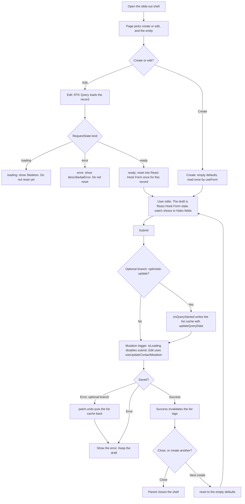

# Enterprise forms

This is the map for the Contact, Connection, and Location forms that open in a slide-out panel.

Two kinds of sentences live here:

- **Already in this repo.** These point at real files and real names.
- **Intended.** These describe folders and packages we have not added yet. Do not go looking for them in the tree.

Build new features with `pnpm new:feature <name>`. That copies `src/features/sampleItems`. Then follow the lint errors until `api.ts` and `model.ts` read the BFF hooks.

## What is already here

- Owned shadcn widgets live in `src/shared/ui`. The files today are `button.tsx`, `input.tsx`, `card.tsx`, `alert.tsx`, `badge.tsx`, `skeleton.tsx`, `toggle.tsx`, and `toggle-group.tsx`. `input.tsx` exports `Input`. Add more with `pnpm dlx shadcn@latest add <component>`. The CLI writes `src/shared/ui`, and the app owns those copies.
- Server data lives in RTK Query. `src/shared/api/baseApi.ts` creates the API. `pnpm api:generate` writes `src/shared/api/generated/**`. Nobody edits those files.
- The sample query hook is `useGetTemplateSampleItemsQuery`, from `src/shared/api/generated/sample`. A feature wraps a hook in its `api.ts` and returns `RequestState<T>` through `toRequestState` (`src/shared/api/requestState.ts`). Screens switch on `kind` and show errors with `describeApiError`.
- The BFF barrel is `src/shared/api/generated/bff`. It exports `bffApi`. Its `endpoints.gen.ts` is empty until a real spec is generated.
- Zod is already a dependency. Search params are parsed in a feature `search.ts`. `src/features/sampleItems/search.ts` puts `.default()` and `.catch()` on every field. Domain ids are branded in `model.ts`, the way `SampleItemId` is.
- Routes are files in `src/routes/`. `src/routes/index.tsx` only wires `validateSearch`, `loaderDeps`, `loader`, and `component`. The loader prefetches with `context.store.dispatch(...)`. The component still reads through the hook.
- A feature's public door is `index.ts`. Other features import `@/features/<name>` and nothing deeper.

## What is not here yet

`react-hook-form` is not in `package.json`. Neither is a zod resolver package. There is no Select, Checkbox, Label, or Sheet widget. There is no `useUpdateContactMutation`. The folders below are the intended shape.

When a real BFF spec has an operation id `updateContact`, codegen names the hook `useUpdateContactMutation` and puts it on `src/shared/api/generated/bff`. The same rule turns `getTemplateSampleItems` into `useGetTemplateSampleItemsQuery` today.

# 1. The four layers

Each layer has one job. It may use the layer just under it. It does not skip a layer to do that layer's job.

```text
slide-out shell          draws the panel, renders children
entity forms             ContactForm, ConnectionForm, LocationForm
form kit                 binds a dumb field to React Hook Form
React Hook Form          holds the draft the user is typing
Interstate               dumb fields: label, value, change, error text
src/shared/ui            shadcn widgets: Input, and later Select, Checkbox
```

## Interstate, and how it relates to `src/shared/ui`

`src/shared/ui` stays the shadcn shelf. Those files stay in the shape the CLI expects, so `shadcn add` and `shadcn diff` keep working. They are dumb HTML. `Input` is already one of them.

Interstate is the field shelf, in a new folder: `src/shared/interstate`. It is owned source, same idea as the shadcn copies, and it knows nothing about forms. It does not get its own `Input`. A missing widget is added to `src/shared/ui` first. Interstate imports that widget and adds a label, a hint, and a slot for an error string.

The props on an Interstate field are plain: `value`, `onChange`, `onBlur`, `name`, `disabled`, `invalid`, and `message`.

Say the widget names and the field names apart:

| People say | shadcn file, in `src/shared/ui` | Interstate field |
| ---------- | ------------------------------- | ---------------- |
| Input      | `input.tsx` (already here)      | `TextField`      |
| Select     | `select.tsx` (add with CLI)     | `SelectField`    |
| Checkbox   | `checkbox.tsx` (add with CLI)   | `CheckboxField`  |

`label.tsx` is also added with the CLI, and Interstate uses it for the visible label. `sheet.tsx` is added the same way. The shell uses Sheet. Interstate does not.

## React Hook Form

React Hook Form is the state engine. It is a library, not a folder. The draft (what the user has typed, including invalid text) lives here until submit.

Wire fields with `Controller`. The only file that imports `Controller` is the form kit's `FormField.tsx`. Entity forms call `useForm`, put `FormProvider` around the fields, and call `watch` when one answer should show or hide another field.

`useForm` is given the empty defaults. Those are a constant from the feature's `model.ts`. The edit screen calls `reset` when the load finishes. Details are in the runtime section.

## The form kit

The form kit is generic glue in `src/shared/forms`. It knows React Hook Form and Interstate. It does not know what a contact is.

- `FormField` renders `Controller` and passes the controller's `value`, `onChange`, `onBlur`, `name`, and error message into an Interstate field.
- `useDirtyGuard` is the shared unsaved-changes prompt. It watches `formState.isDirty`. When something asks to close, it either closes or asks the user first.
- `useSubmitAndClose` runs the save. On success it tells the parent to close, or it `reset`s to the empty defaults so the user can create another. The submit button's disabled flag is the mutation's `isLoading`.

## Entity forms

Each entity is a feature, copied from `src/features/sampleItems`.

| Feature       | Form file            | Route file                   |
| ------------- | -------------------- | ---------------------------- |
| `contacts`    | `ContactForm.tsx`    | `src/routes/contacts.tsx`    |
| `connections` | `ConnectionForm.tsx` | `src/routes/connections.tsx` |
| `locations`   | `LocationForm.tsx`   | `src/routes/locations.tsx`   |

Each feature folder holds the same jobs as the sample:

- `index.ts` exports the page, the form, the search schema, and the prefetch helper.
- `api.ts` wraps the generated hooks and returns `RequestState` for reads. It is the file that calls `useUpdateContactMutation`.
- `model.ts` holds the domain type, the branded id, `toContact` (server item to domain), `emptyContactForm`, `toContactFormValues`, and `toUpdateContactBody`. Those mappers are plain functions. It may import generated types, the way `src/features/sampleItems/model.ts` imports `TemplateSampleItem`.
- `search.ts` holds the zod schema for the route. Every field gets `.default()` and `.catch()`.
- The form composes `FormField` plus Interstate fields. It owns defaults and the submit handler.

The edit screen's mutation wrapper returns the generated tuple. The form sees this shape:

```ts
const [updateContact, { isLoading }] = useUpdateContactMutation();
```

`ContactForm` does not import that hook. `src/features/contacts/api.ts` imports it and returns it. Create uses the same tuple from the create hook. Connection and Location do the same with their own hooks.

Mode is a small union, matching the `kind` style in `RequestState`:

```ts
type ContactFormMode = { kind: "create" } | { kind: "edit"; id: ContactId };
```

## The slide-out shell

The shell is `src/shared/shell/SlideOutShell.tsx`. It draws the panel with the Sheet widget from `src/shared/ui`. Its props are `open`, `title`, `onClose`, and `children`.

Any entity form can be the child. The page picks the child. `SlideOutShell.tsx` never imports `ContactForm`, `ConnectionForm`, or `LocationForm`.

Each entity page passes its own form. A screen that can open more than one entity keeps the switch in the page, outside the shell file:

```tsx
function EnterprisePage() {
	return (
		<SlideOutShell open={open} title={title} onClose={guard.requestClose}>
			{panel === "contact" ? <ContactForm mode={mode} onDone={close} /> : null}
			{panel === "connection" ? <ConnectionForm mode={mode} onDone={close} /> : null}
			{panel === "location" ? <LocationForm mode={mode} onDone={close} /> : null}
		</SlideOutShell>
	);
}
```

`EnterprisePage` is the page component in whichever feature owns that screen. It imports the other forms through `@/features/contacts`, `@/features/connections`, and `@/features/locations`.

`open`, the panel name, the mode, and the id live in the route search params, the same way `sampleItems` keeps its filters. The page reads them. The shell only receives `open` and `onClose`.

`useDirtyGuard` sits in the page so the shell's X button and the form share one close path. The guard is form-kit code. It still does not know which entity is on screen. The form reports dirty through it. The shell only sees `onClose`.

## Intended file list

Already in the repo:

```text
src/shared/ui/input.tsx
src/shared/ui/button.tsx
src/shared/api/baseApi.ts
src/shared/api/requestState.ts
src/shared/api/apiError.ts
src/shared/api/generated/bff/index.ts
src/shared/api/generated/sample/endpoints.gen.ts
src/features/sampleItems/api.ts
src/features/sampleItems/model.ts
src/features/sampleItems/search.ts
src/features/sampleItems/index.ts
src/routes/index.tsx
```

Intended. Add the shadcn files with the CLI. The other files are app code:

```text
src/shared/ui/select.tsx
src/shared/ui/checkbox.tsx
src/shared/ui/label.tsx
src/shared/ui/sheet.tsx

src/shared/interstate/index.ts
src/shared/interstate/TextField.tsx
src/shared/interstate/SelectField.tsx
src/shared/interstate/CheckboxField.tsx

src/shared/forms/index.ts
src/shared/forms/FormField.tsx
src/shared/forms/useDirtyGuard.ts
src/shared/forms/useSubmitAndClose.ts

src/shared/shell/index.ts
src/shared/shell/SlideOutShell.tsx

src/features/contacts/index.ts
src/features/contacts/api.ts
src/features/contacts/model.ts
src/features/contacts/search.ts
src/features/contacts/ContactForm.tsx
src/features/contacts/ContactsPage.tsx

src/features/connections/index.ts
src/features/connections/api.ts
src/features/connections/model.ts
src/features/connections/search.ts
src/features/connections/ConnectionForm.tsx
src/features/connections/ConnectionsPage.tsx

src/features/locations/index.ts
src/features/locations/api.ts
src/features/locations/model.ts
src/features/locations/search.ts
src/features/locations/LocationForm.tsx
src/features/locations/LocationsPage.tsx

src/routes/contacts.tsx
src/routes/connections.tsx
src/routes/locations.tsx
```

Import doors, matching this repo: features through `@/features/<name>`, Interstate through `@/shared/interstate`, the form kit through `@/shared/forms`, the shell through `@/shared/shell`. shadcn widgets stay direct file imports, as in `@/shared/ui/input`. Generated code stays inside that feature's `api.ts` and `model.ts`. Hooks stay in `api.ts`.

# 2. Runtime flow



Read the arrows in order:

1. The page opens the shell. Search params say which panel, which mode, and, for edit, which id.
2. Create skips the load. `useForm({ defaultValues: emptyContactForm })` reads those empty values once.
3. Edit prefetches in the route loader, then the form reads `useContact(id)`, which returns `RequestState`. `loading` shows `Skeleton`. `error` shows `describeApiError`. `ready` calls `reset(toContactFormValues(record))` once for that record.
4. Typing updates React Hook Form only. `watch("someField")` in the entity form shows or hides other fields. Interstate just receives the next `value`.
5. Submit calls the trigger from the feature `api.ts`. For edit, that trigger is `useUpdateContactMutation`. While `isLoading` is true, the submit button is disabled.
6. Success is handled by the endpoint's `invalidatesTags`, so the list query refreshes. The form then calls `onDone` and the page closes the shell. "Save and add another" calls `reset(emptyContactForm)` and leaves the shell open.
7. A failed save leaves the draft in React Hook Form so the user can fix it.

`reset` depends on the record id and the loaded data reference. A new render of the same record must not call `reset` again. That second call would wipe what the user has typed.

## Optional branch: optimistic update

Skip this until the plain save works. It does not belong in the component.

The feature `api.ts` adds it with `bffApi.enhanceEndpoints`. Generated files stay untouched. `src/shared/api/baseApi.ts` has no `tagTypes` today. The first entity that invalidates a list adds the tag names there.

On the edit mutation:

- `onQueryStarted` runs before the request finishes.
- `bffApi.util.updateQueryData` writes the edited row into the cached list. Keep the returned patch.
- `await queryFulfilled`.
- On failure, `patch.undo()` puts the cache back.
- The normal error path (no optimistic write) has nothing to undo. It only keeps the draft and shows the error.

Success still invalidates the list tags, so the server copy replaces the optimistic row after the save.

# 3. Plain English for a new dev

You are building a form that slides in from the side. The user might be creating a contact or editing one. The same panel is also used for a connection and a location. The pieces stay dumb on purpose, so the next form is mostly a new list of fields.

## Why each layer exists

**shadcn (`src/shared/ui`).** This is the box, the button, the bare text input. We copy them into the repo so we can see the code. They paint pixels. They do not know if the user has unsaved work.

**Interstate.** This is a labeled field. It takes a value and tells you when that value changed. It also shows an error string if you hand it one. We keep it apart from the shadcn file so a form library never leaks into the design-system copies.

**React Hook Form.** This remembers the draft. The server data is the last saved copy. The draft is what is on screen right now, typos included. One library should own that memory. A `useState` copy of the form will drift from it.

**Form kit.** This is the reusable glue: one wrapper that connects a field to the draft, one dirty check, one submit-and-close path. Contact, Connection, and Location all get the same close prompt and the same disabled submit button.

**Entity form.** This is the only layer that knows a contact has a name and an email. It picks the fields, the empty defaults, and the save function.

**Shell.** This is the drawer. It opens, it closes, it shows whatever child you give it. The page decides which form that child is.

## What each layer must not do

- **shadcn widgets** must not import React Hook Form, RTK Query, or a feature.
- **Interstate** must not import React Hook Form, `Controller`, `useForm`, RTK Query, or any feature. It must not decide that a field is required. It must not fetch data.
- **React Hook Form** is only the draft. It is not a cache for server lists, and it is not the router.
- **The form kit** must not mention Contact, Connection, or Location. It must not import `@/shared/api/generated`. It must not call a mutation itself. The entity form hands it the trigger.
- **The entity form** must not import generated hooks. That import stays in `api.ts`. It must not paint a raw `<input>` when an Interstate field exists. It must not teach the shell the entity's field names.
- **The shell** must not import an entity form, a feature, React Hook Form, or the generated API. It must not switch on "contact" or "edit".

## Common mistakes

**Feeding the query into `defaultValues` on every render.** `useForm` reads `defaultValues` only on the first render. The first render is usually still loading, so the form sticks on the empty values. Passing the query result in again on the next render does not refill it. When the load is `ready`, call `reset` once. Do not call `reset` on every render of the same record.

**Putting form logic in Interstate.** If a field starts calling `watch`, `useFormContext`, or a mutation, the next screen cannot reuse it. The error string is a prop. The form kit decides what the string is.

**Letting the shell know the entity.** The shell does not import the three forms, and it does not contain a switch on the entity name. The page passes one form as `children`. A new entity is a new child, not a new shell.

**Copying server data into local state.** RTK Query already stores the saved contact. React Hook Form stores the draft. A third `useState` copy goes stale, and the list stops updating when tags are invalidated. Read the query through the feature hook. Map it with a pure function in `model.ts`. `reset` that into the form when the load completes.

**Importing the generated hook from the form.** Lint allows `@/shared/api/generated` only in `api.ts` and `model.ts`. The form calls the wrapper. The edit wrapper's shape is still `useUpdateContactMutation`: a trigger function, plus `{ isLoading }`.

**Closing on submit by hand inside the shell.** The form kit runs the mutation. On success the endpoint invalidates the list tags, then the form calls `onDone`. The page closes the shell. The shell does not listen for a save.
